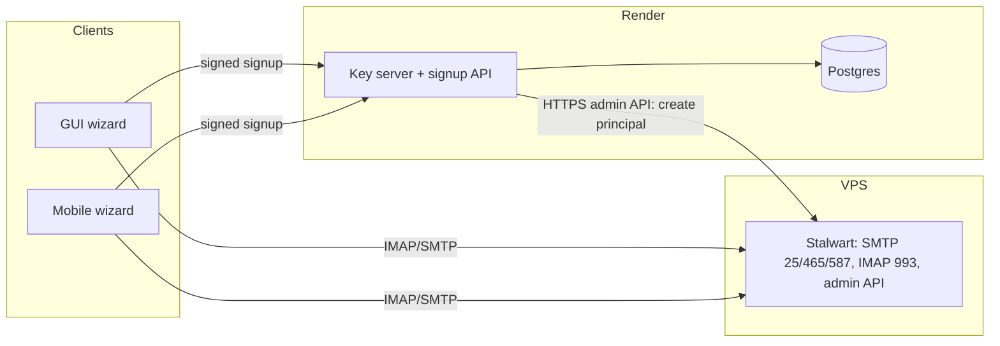

# EBP Email + Key Onboarding Wizard

## Goal

A first-run wizard on the desktop GUI and Android: **pick a username, set a password, save a recovery phrase, done.** At the end the user has:

- an HD identity on this device, published to the key server;
- a `username@<MAIL_DOMAIN>` mailbox;
- a server-verified `email` detail attached to the identity;
- a mail account configured locally, so the inbox opens straight away.

IMAP and SMTP settings stay out of sight unless the user asks for them.

This replaces the never-started [ebp_managed_email_signup_717f2a2e.plan.md](.cursor/plans/ebp_managed_email_signup_717f2a2e.plan.md). That plan used Postfix + Dovecot and a GUI-only form.

## Architecture

Render can only expose HTTPS: there is no public port 25 or 993, and outbound port 25 is blocked on every plan. So the key server and signup API stay on Render, and Stalwart runs on a small VPS.

## Wizard flow (same on both clients)

1. **Welcome.** "Get a quantum-secure email address."
2. **Choose address.** A username field showing `@<MAIL_DOMAIN>`, with a debounced availability check. Rules: 3–30 characters, `[a-z0-9.-]`, and not a reserved name (`admin`, `postmaster`, `abuse`, and so on).
3. **Password.** The identity password. It uses the existing policy from [wiki/password-policy.md](wiki/password-policy.md).
4. **Recovery phrase.** A 24-word EBP-HD mnemonic. The user confirms it by entering 3 randomly chosen words.
5. **Create.** Shows a progress list of these steps:
   - create the HD identity using existing services (GUI `/hd/mnemonic` + `/hd/identity`; mobile `services/hd.ts`);
   - publish it (GUI `/publish`; mobile `services/publish.ts`);
   - generate a random mailbox password (32 characters) on the device;
   - sign an `email` detail proof for `username@MAIL_DOMAIN`;
   - call `POST /api/v1/mail/signup`;
   - save the local mail account.
6. **Done.** Shows the address and fingerprint, plus an "Open inbox" button. A collapsed "Use in other mail apps" section reveals the host, ports, username, and mailbox password.

**Where the wizard appears:**
- GUI: automatically on first run (no identities), and from a "Create EBP email" button on the Mail page.
- Mobile: from the empty state of [IdentitiesHomeScreen.tsx](mobile/src/screens/IdentitiesHomeScreen.tsx), and from [MailAccountsScreen.tsx](mobile/src/screens/mail/MailAccountsScreen.tsx).

The existing advanced create and manual mail setup flows stay as they are.

## Server changes ([server/](server/))

**`mailboxes` table.** Added in [server/db/postgres.ts](server/db/postgres.ts) and [server/db/sqlite.ts](server/db/sqlite.ts), with helpers in [server/db/index.ts](server/db/index.ts). Columns: `username`, `domain`, `fingerprint` (FK to identities), `active`, `created_at`, and a unique constraint on `(username, domain)`. No password hashes are stored here; Stalwart owns credentials.

**New handlers in `server/handlers/mail-signup.ts`**, wired into the route chain in [server/main.ts](server/main.ts):

- `GET /api/v1/mail/username-available?u=` checks the reserved list, the `mailboxes` table, and Stalwart.
- `POST /api/v1/mail/signup` accepts `{ fingerprint, username, mailPassword, detailProof }`. It:
  1. requires a published identity;
  2. requires that the fingerprint has no mailbox yet (limit 1 per identity);
  3. verifies `detailProof` for path `email` with detail `username@MAIL_DOMAIN`, reusing `verifyDetailProof` (as in [server/handlers/identity.ts](server/handlers/identity.ts) ~line 331);
  4. creates the Stalwart principal (`type: individual`, secret, email, quota);
  5. inserts the detail and sets `verified_at`, because the server issued the address.

  If any step fails, the Stalwart principal is rolled back.
- `POST /api/v1/mail/reset-password` takes a fresh identity-signed request (nonce + timestamp) and resets the Stalwart secret. This lets a user who restores from the recovery phrase on a new device get back into their mailbox.

**Stalwart client: `server/stalwart.ts`.** A thin `fetch` wrapper around the admin API (create, delete, and set-secret on a principal). The exact endpoint shapes must be checked against the Stalwart docs for the deployed version.

**Rate limits** in [server/rate-limit.ts](server/rate-limit.ts): signup 3 per hour per IP; availability check 60 per minute.

**New env vars:**
- `MAIL_SIGNUP_ENABLED` (default off);
- `MAIL_DOMAIN`;
- `MAIL_HOST`;
- `STALWART_ADMIN_URL` and `STALWART_ADMIN_TOKEN`;
- `MAIL_QUOTA_BYTES`.

The server will also expose `GET /api/v1/mail/signup/config`, returning `{ enabled, domain, imap, smtp }` so clients never hard-code hosts. The existing `SMTP_*` verification mailer can be pointed at Stalwart as well.

**Tests** in [server/tests/](server/tests/): availability, reserved names, a bad proof, a duplicate username, one mailbox per fingerprint, and rollback when Stalwart fails (using a mocked Stalwart).

## GUI changes

- Wizard markup is a modal or page in [gui/index.html](gui/index.html). The logic goes in a new `gui/js/onboarding.js`, loaded from [gui/app.js](gui/app.js). The first-run trigger lives in `initNavigation`/`loadAll`, which run when no identities exist.
- A local backend proxy route in [gui/local-backend/routes.ts](gui/local-backend/routes.ts), `POST /api/v1/mail/ebp-signup`, which:
  - unlocks the identity with the password;
  - signs the `email` detail proof;
  - forwards the request to the key server;
  - on success, saves the account through the same code path as `POST /api/v1/mail/account` (~line 814), using the existing mail PIN prompt.
- Tests:
  - backend tests in [gui/local-backend/tests/](gui/local-backend/tests/) using a stubbed key server;
  - a Playwright `gui/e2e/onboarding.spec.ts` with signup mocked at the backend.

## Mobile changes

- A new stack screen `OnboardingWizardScreen.tsx` in [AppNavigator.tsx](mobile/src/navigation/AppNavigator.tsx).
- `services/mail/ebpSignup.ts` holds the I/O; `ebpSignupLogic.ts` holds pure helpers: username validation, request building, and mapping the config response to an account config. This follows the existing `*Logic.ts` pattern.
- The account is saved with `saveMailAccountWithSecrets` in [accountStore.ts](mobile/src/services/mail/accountStore.ts).
- Tests:
  - Jest tests for the logic file;
  - a Maestro flow `mobile/e2e/onboarding.yaml` that goes as far as the Create step against a test server with signup enabled.

## Infrastructure: VPS + Stalwart (new `mail-server/` dir)

- `mail-server/docker-compose.yml` runs the Stalwart image. Data goes on a volume, and TLS comes from Stalwart's built-in ACME.
- `mail-server/README.md` covers:
  - VPS choice: Hetzner CX22 (~4 EUR/month), where you request port 25 unblocking after the first invoice. Vultr is the fallback. Avoid DigitalOcean, which blocks port 25.
  - Setting a PTR/rDNS record to `mail.<domain>`.
  - DNS records: MX, A for `mail.`, SPF, DKIM (generated by Stalwart), DMARC, and optionally MTA-STS.
  - Creating the admin API token.
  - Stalwart settings: allow only authenticated submission, set per-account quotas and an outbound rate limit.

## Domain choice and purchase

The registrar doesn't affect how many mailboxes you can have: Stalwart creates unlimited accounts, and the registrar only provides DNS. Network Solutions works, but it costs more and upsells. **Cloudflare Registrar** sells at cost (.com ~$10.50/yr) and its DNS is good. Porkbun is a good alternative.

One rule if you use Cloudflare: set the `mail.` A record to "DNS only" (grey cloud).

Shortlist. Registry RDAP lookups on 2026-10-18 returned "not found", meaning unregistered:

- `pqpost.com` (recommended): short, means "post-quantum post", and a .com.
- `pqmail.org`
- `ebpmail.org` / `ebpmail.net`

Already taken: `ebpmail.com`, `pqmail.com`, `pqmail.net`, `pq.email`, `ebp.email`.

**Text step.** Once the plan is approved, re-check availability, then send the shortlist and buying steps by Phonebox SMS to William (iPhone).

Never text the handset that will be USB-attached for Android testing.

## Wiki

- New `wiki/analysis-ebp-managed-email-onboarding.md` (architecture, the Render limitation, abuse controls).
- Updates to [wiki/email-transport.md](wiki/email-transport.md), [wiki/component-server.md](wiki/component-server.md), [wiki/component-gui.md](wiki/component-gui.md), [wiki/component-mobile.md](wiki/component-mobile.md), [wiki/index.md](wiki/index.md), and [wiki/log.md](wiki/log.md).
- Mark [analysis-email-backed-chat.md](wiki/analysis-email-backed-chat.md) as related.

## Open risks

- **Deliverability.** A fresh domain and IP will land in spam at first. DKIM, DMARC, and rDNS are mandatory, and warm-up takes weeks.
- **Abuse.** Open signup invites spammers. The defenses are the rate limits, one mailbox per published identity, outbound limits in Stalwart, and the `MAIL_SIGNUP_ENABLED` kill switch.
- **Stalwart admin API shape.** Pin the image version and verify the endpoints before writing `server/stalwart.ts`.