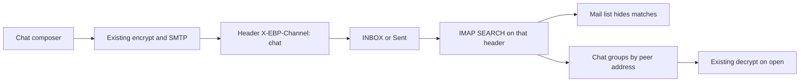

# pqpost chat on desktop and mobile

Chat is a second view of the same mailbox. A message is still SMTP/IMAP plus an encrypted-and-signed EBP payload. The split is the header `X-EBP-Channel: chat` and the fixed subject `Chat`, as in [wiki/analysis-pqpost-chat-channel.md](wiki/analysis-pqpost-chat-channel.md).

## Shared rules

Put the constants and pure grouping in [core/ChatChannel.ts](core/ChatChannel.ts) (plus a Deno test):

- Header name `X-EBP-Channel`, value `chat` (match case-insensitively).
- Subject token `Chat`.
- Peer key is `normalizeEmail` from [core/MailAuthenticity.ts](core/MailAuthenticity.ts). For a message in INBOX the peer is From; in Sent it is To. Drop messages whose peer is the account’s own address.
- A conversation is that peer, sorted by date. Unread is an inbound message without `\Seen`.

Chat is allowed only when the peer’s domain equals the active account’s From domain (production is `pqpost.com`; dev domains keep working). One recipient. No attachments, Cc, or cleartext send. If recipient resolve does not end on an encrypted contact, send stays disabled. Reuse the existing resolve path: GUI [gui/js/compose-recipients.js](gui/js/compose-recipients.js) / `resolveVerifiedEmailContact`, mobile [mobile/src/services/mail/recipientChipsLogic.ts](mobile/src/services/mail/recipientChipsLogic.ts).

Classification is the header, not a decrypt of every row. A chat row that fails decrypt or verify stays in the thread as an error, with a way to open the existing mail reader for that UID. That avoids pulling full MIME just to decide which list owns the message.

While a chat screen is visible, refresh the header search about every 20 seconds and again on focus. Neither IMAP stack holds a connection today, and the mobile client is a line reader, so IMAP IDLE stays out of this pass.

## Desktop

Backend in [gui/local-backend/routes.ts](gui/local-backend/routes.ts) and [gui/local-backend/mail-send.ts](gui/local-backend/mail-send.ts):

- Extend `OutboundMail` with optional `headers`, `messageId`, `inReplyTo`, and `references`. Nodemailer already accepts those. `POST /mail/send-ebp` accepts `channel: "chat"` and then forces subject `Chat`, sets the header, ignores attachments, and passes threading fields through.
- Mail list (`GET /mail/messages`) searches with IMAP `NOT HEADER X-EBP-Channel chat` before pagination, so a page of chat mail does not show up as an empty inbox. Apply the same exclusion on Sent.
- Add `GET /mail/chat`: `SEARCH HEADER X-EBP-Channel chat` on INBOX and on the Sent mailbox ([core/SentMailbox.ts](core/SentMailbox.ts)), cap to the newest 200 UIDs per folder, return grouped conversations plus per-message `uid`, `folder`, `date`, `seen`, and `messageId`. Envelope already has `messageId`; include it in the fetch. No bodies.
- Add `POST /mail/message/seen` using ImapFlow `messageFlagsAdd` so opening a thread sets `\Seen` on inbound rows. Reading mail today never stores that flag.

UI: a sidebar item next to Mail in [gui/index.html](gui/index.html) (`data-page="chat"`) and `#page-chat`. [gui/app.js](gui/app.js) `navigateTo` loads it the same way Mail does (unlock the mail account, then fetch). Layout is a conversation list plus a thread: peer label, time-ordered bubbles, a single address field for a new chat, and a text box. Sending calls `/mail/send-ebp` with `channel: "chat"` and `inReplyTo` / `references` set from the latest message in that thread. Bubbles use the existing `POST /decrypt` path and the identity unlock session. Mail inbox rendering in [gui/js/mail.js](gui/js/mail.js) stays as it is once the list API excludes the header.

## Mobile

- [mobile/src/services/mail/imap.ts](mobile/src/services/mail/imap.ts): inbox `UID SEARCH` becomes `NOT HEADER X-EBP-Channel chat` (still paginated). Add a chat fetch that searches INBOX and Sent, then `HEADER.FIELDS` including `X-EBP-CHANNEL` and `MESSAGE-ID`. Add `UID STORE <uid> +FLAGS (\Seen)`.
- [mobile/src/services/mail/mime.ts](mobile/src/services/mail/mime.ts) and `sendEbpMail` in [mobile/src/services/mail/ebpMail.ts](mobile/src/services/mail/ebpMail.ts): optional channel header, fixed subject, and a generated `Message-ID` when the caller does not supply one. Mobile send today does not write `Message-ID`, so the other client could not thread a reply.
- New tab beside Mail in [mobile/src/navigation/AppNavigator.tsx](mobile/src/navigation/AppNavigator.tsx): conversation list, thread, and new-chat. Reuse `ListRow`, `TextField`, `Screen`, and recipient resolve. Thread loads the newest 40 bodies via the existing `fetchMessageDetail` + `decryptMailBody` path. Bubbles are new views using [mobile/src/theme/tokens.ts](mobile/src/theme/tokens.ts). No quoted body.

## Tests and wiki

- Core: header match and peer grouping, including display-name addresses and own-address exclusion.
- GUI: [gui/local-backend/tests/mail_sent_copy_test.ts](gui/local-backend/tests/mail_sent_copy_test.ts) asserts the chat header, subject `Chat`, and `In-Reply-To` on `compileRawMessage`. A mocked Playwright case in [gui/e2e/mail-compose.spec.ts](gui/e2e/mail-compose.spec.ts) (or a small sibling spec) opens Chat, sends, and checks the `/mail/send-ebp` body. Inbox fixtures with the header do not render in the mail list.
- Mobile: extend [mobile/__tests__/mailReply-test.ts](mobile/__tests__/mailReply-test.ts) and [mobile/__tests__/mailMailbox-test.ts](mobile/__tests__/mailMailbox-test.ts) for the header, `Message-ID`, `SEARCH HEADER`, and `\Seen` store.
- Update [wiki/analysis-pqpost-chat-channel.md](wiki/analysis-pqpost-chat-channel.md), the GUI and mobile component pages, [wiki/index.md](wiki/index.md), and [wiki/log.md](wiki/log.md).
