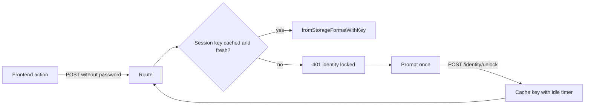

# Unlock identity once per session

## Today
- GUI: every private-key route re-runs Argon2id via `loadIdentity(ctx, password)` in [gui/local-backend/identity.ts](gui/local-backend/identity.ts). About 20 `requestPassword` call sites across [gui/js/mail.js](gui/js/mail.js), [gui/app.js](gui/app.js), [gui/js/hierarchy.js](gui/js/hierarchy.js), and [gui/js/render.js](gui/js/render.js).
- Mail PIN cache in [gui/local-backend/mail-account.ts](gui/local-backend/mail-account.ts) (`mailSecretCache`, `mailPinCache`) lives until the process exits, with no lock or timeout.
- Mobile: `loadIdentity(name, password)` in [mobile/src/services/storage.ts](mobile/src/services/storage.ts) uses `deriveIdentityKey` + `Identity.fromStorageFormatWithKey`. There is no cache and no `AppState` listener.

## Design
Cache the **derived storage key** (`AES.deriveKeyForStorage`), not the `Identity` object. Each request still re-reads the identity file with `Identity.fromStorageFormatWithKey`, so detail nonces and re-saves stay correct. If the file's salt changes, for example after a password change, the key fails to decrypt and the cache entry is evicted.

## GUI backend
- New [gui/local-backend/unlock-session.ts](gui/local-backend/unlock-session.ts): a `Map<identityPath, { key, salt, expiresAt }>` with sliding idle expiry.
  - `unlockIdentity(ctx, password, timeoutMin)`
  - `lockIdentity(ctx)` / `lockAll()`
  - `getUnlockStatus(ctx)`
  - `loadIdentityForRequest(ctx, password?)`: use the password when given and refresh the session; otherwise use the cache; otherwise throw 401 `identity locked`.
- Routes in [gui/local-backend/routes.ts](gui/local-backend/routes.ts):
  - `POST /api/v1/identity/unlock`
  - `POST /api/v1/identity/lock`
  - `GET /api/v1/identity/unlock-status`
- Replace `loadIdentity(ctx, body.password)` with `loadIdentityForRequest` in the decrypt, mail send-ebp, decrypt-attachment, sign, encrypt, encrypt-file, decrypt-file, publish, detail, hierarchy propose/accept/reject, revoke, and export-public routes. This also fixes the reject-proposal bug, where the route removes the local entry before it fails for lack of a password (around lines 2887-2899).
- Hardening, since unlocked keys now sit in memory:
  - Remove the `"null"` origin from the allow-list in [gui/local-backend/security.ts](gui/local-backend/security.ts). The sandboxed mail iframe has a null origin. First check that Tauri never sends `null`.
  - All key-using routes stay POST, so the CSRF token is required.
- Email PIN merge:
  - On a successful identity unlock, silently try `unlockMailSecretsWithPin(identityPassword)`. Managed signups already default the PIN to the identity password (ebp-signup around 4473-4480).
  - Add `clearMailSecrets(ctx)` and call it from lock and expiry.
  - Manual accounts with a different PIN keep the existing prompt.

## GUI frontend
- New [gui/js/unlock.js](gui/js/unlock.js) with `withIdentity(fn)`:
  1. Call `fn({})`.
  2. On 401 `identity locked`, prompt once and `POST /identity/unlock`.
  3. Retry the call.
- Replace each `requestPassword(...)` call site with `withIdentity`. Identity creation flows keep setting a new password.
- Add an "Unlocked / Lock" pill in the app header, driven by `unlock-status` polling or the response of each call.
- In the Settings Identity section ([gui/index.html](gui/index.html) around 4192), add an "Auto-lock after" select (5/15/60 minutes, default 15). Add a numeric preference helper to [gui/js/state.js](gui/js/state.js).

## Mobile
- New [mobile/src/services/unlockSession.ts](mobile/src/services/unlockSession.ts): a cache from identity name to derived key, an idle timer, and an `AppState` listener that locks when the app has been in the background longer than the timeout.
- Add `loadIdentityUnlocked(name)` in `storage.ts`, and a `useIdentityUnlock()` hook that wraps `useSecretPrompt` and prompts only when locked.
- Migrate the prompt sites (crypto screens, `MailMessageScreen`, `CertificatesScreen`, `IdentityDetailScreen`) and the inline password field in `MailComposeScreen`.
- Mail PIN: on identity unlock, try `unlockMailSecretsWithPin` in [mobile/src/services/mail/accountStore.ts](mobile/src/services/mail/accountStore.ts) with the same password, and clear it on lock.
- Add an auto-lock setting in [mobile/src/screens/SettingsScreen.tsx](mobile/src/screens/SettingsScreen.tsx) and [mobile/src/services/settings.ts](mobile/src/services/settings.ts). Biometrics are deferred.

## Tests
- Unit tests for `unlock-session.ts`: expiry, eviction on salt change, and lock clearing mail secrets. Note that `gui/local-backend/tests/main_test.ts` runs a forked `tests/test_handler.ts`, so add the unlock routes there or test the module directly.
- GUI e2e: unlock once, decrypt two messages, and send with a single password prompt; Lock forces a new prompt.
- Mobile jest for `unlockSession` timer and background logic.
- Update the wiki: [[component-gui]], [[component-mobile]], [[key-management]].
