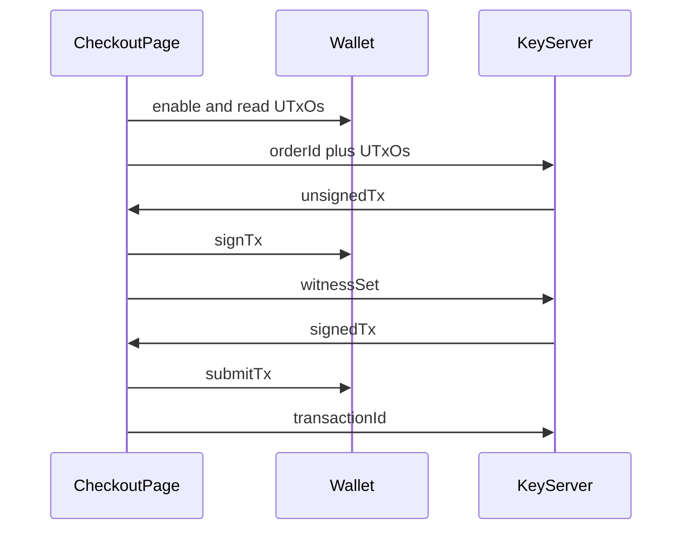

# Testnet wallet checkout

Short `@pqpost.com` names stay unavailable. Wallet payment is only for `@test.pqpost.com` orders on `ethereum-sepolia` (native ETH) and `cardano-preview` (ADA). The existing transaction-id form stays as a fallback for those test orders.

## Block production short names

In [server/handlers/mail-signup.ts](server/handlers/mail-signup.ts), a short name on `pqpost.com` always returns “not available for registration yet.” `purchasable` is only possible when the request is in test mode and the domain is `test.pqpost.com`. [server/handlers/mail-payment.ts](server/handlers/mail-payment.ts) `handlePaymentCreate` rejects any order whose domain is not `test.pqpost.com` or whose network is not `ethereum-sepolia` or `cardano-preview`.

## Ethereum: the page sends the transaction

[website/checkout.js](website/checkout.js) gets a Pay button when the loaded order is quoted, `@test.pqpost.com`, and native Sepolia ETH.

- `eth_requestAccounts`, then `wallet_switchEthereumChain` to chain id `0xaa36a7` (11155111).
- `eth_sendTransaction` with `from`, `to` = recipient, `value` = quoted wei as hex, and `input` = `0x` plus the UTF-8 hex of `order.message`. That is the exact input [server/payments/verification.ts](server/payments/verification.ts) `checkEthereumPayment` accepts. The execution API name is `input`; if the wallet rejects it, retry once with `data` set to the same hex.
- Post the returned hash to the existing `payment/transaction` endpoint and refresh status. No new host, so the checkout CSP stays as it is.

## Cardano: the server builds, the wallet signs and submits

CIP-30 does not include fee parameters, and the Blockfrost key must stay on the server. The static checkout page also cannot load Mesh from a CDN (`script-src 'self'`).

New preview-only endpoints on the key server, using the existing `MAIL_TEST_PAYMENT_BLOCKFROST_KEY` and `@lucid-evolution/lucid` (no spending key):

- The page calls `window.cardano.*.enable()`, requires `getNetworkId() === 0`, and sends the change address plus CIP-30 UTxOs with the order id.
- The server builds an unsigned transaction only for a quoted, unexpired `cardano-preview` ADA order: pay the recipient at least the quoted lovelace, attach metadata label `674` with `msg: [order.message]` as the only 674 entry, and return change to the wallet. If the UTxOs cannot cover the output plus fee, return that error.
- The page calls `signTx`. The server checks the unsigned transaction still matches the order, attaches the witness set, and returns signed CBOR. The page calls `submitTx` and posts that transaction id the same way as Ethereum.

The page tells the buyer the wallet must be on Cardano preview. CIP-30 network id `0` is every testnet, so a preprod wallet cannot be detected here; preview Blockfrost will simply not see that transaction.

Token orders (anything other than native ETH or lovelace) do not get a Pay button.

## Tests

- Server: `pqpost.com` username check is never `purchasable`; payment create rejects a mainnet network.
- Pure helper for the Sepolia transaction object (`to`, `value`, `input`) and the “this order may use a wallet” predicate, including a rejected `@pqpost.com` order.
- Cardano builder test with a fake Blockfrost response: metadata is a single 674 `msg`, and a mainnet or non-lovelace order is refused before any provider call.
